 

    

### `$ whoami`

### `$ ls ~/projects`

<table>
  <tr>
    <td width="50%"></td>
    <td width="50%"></td>
  </tr>
</table>

### `$ cat ~/.stack`

  

### `$ ./stats --live`

  
  

  

  

<code>[ connection closed by remote host ]</code>

